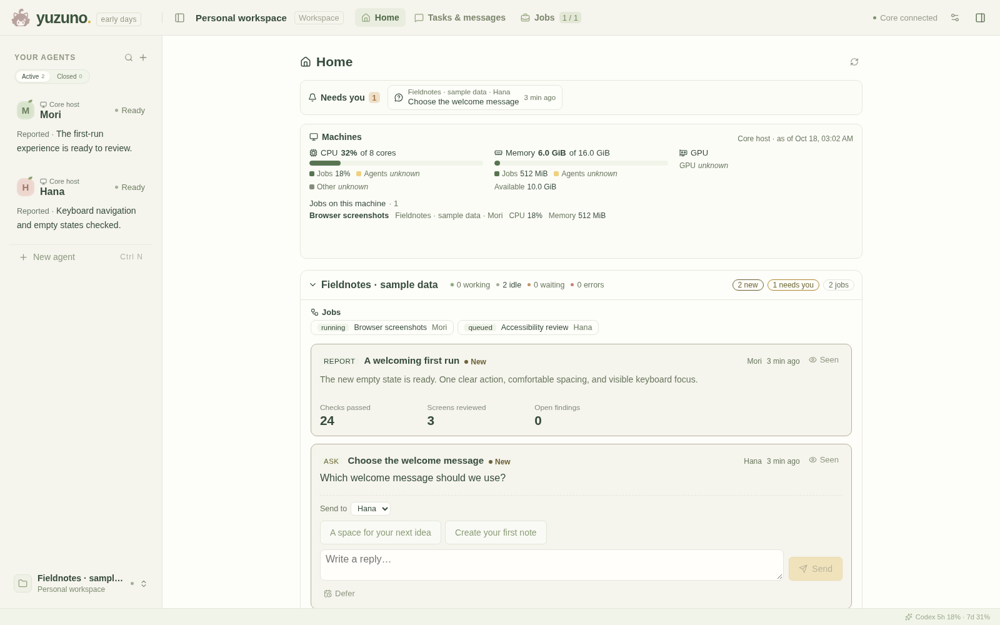
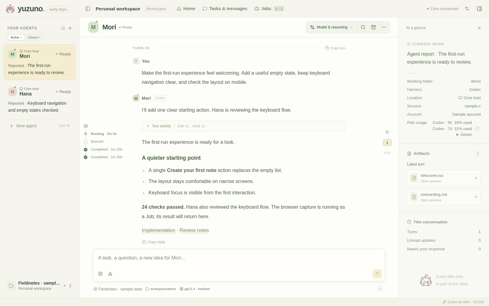
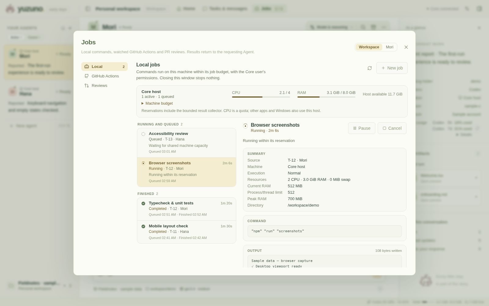

<p align="center">
  
</p>

<h1 align="center">Yuzuno</h1>

<p align="center"><strong>A home for your coding agents.</strong><br />
Codex and Claude, your projects, and the work that carries on between conversations.</p>

<p align="center">
  <a href="https://github.com/YuzukiS/Yuzuno/actions/workflows/ci.yml"></a>
  <a href="#project-status"></a>
  <a href="LICENSE"></a>
  <a href="docs/independent-core.md#supported-platforms"></a>
</p>

<p align="center">
  <a href="docs/independent-core.md"><strong>Install</strong></a> ·
  <a href="#a-workspace-for-continuing-work">Features</a> ·
  <a href="#run-from-source">Quick start</a> ·
  <a href="#how-it-works">How it works</a> ·
  <a href="CONTRIBUTING.md">Contribute</a>
</p>

Yuzuno is a personal workspace for work that spans many agents and many turns. Give each Agent a project directory and a native session, delegate tasks, follow background work, and return to the decisions that need you. Your native Codex and Claude installations continue to handle model execution and sign-in.



<p align="center"><em>Home brings project updates and the decisions that need you into one view. Screenshots throughout this page use fictional sample data.</em></p>

## A workspace for continuing work

| | What you get |
| --- | --- |
| **One place for your agents** | Codex and Claude conversations, tool inputs and results, approvals, follow-ups, images, and native sub-agent activity. Run Agents locally or over SSH on Linux and macOS. |
| **Context when you come back** | Home shows what needs your attention, project briefs written by Agents, and host load. Persistent sessions and saved history help you pick up where you left off. |
| **Tasks that outlive a turn** | Organize Agents by Project, dispatch shared tasks with fixed working materials, and exchange durable mailbox messages. Submitted results return to the dispatcher. |
| **Background work with a budget** | Queue builds, tests and research commands with shared CPU/RAM budgets, logs and output files. Chain dependent stages, declare NVIDIA GPU needs, and pause local computation when you need the machine. |
| **Delivery you can inspect** | Keep local Jobs, independent PR reviews and GitHub CI in one place. Reviews and CI refer to a specific revision; completion, acceptance and merge remain separate facts. |
| **A workspace that feels like yours** | Light and dark themes, adjustable text and panel sizes, project grouping, and a browser or desktop client. |

### Follow the work, then get back to yours

See what an Agent is doing, inspect a tool call, answer an approval, or send a follow-up without opening another terminal. Native sub-agents stay attached to their parent conversation. Account and plan usage are shown when the runtime provides them.



### Give long-running work its own place

Jobs keep commands, resource requests, status, logs and outputs together. Dependent stages start after their prerequisites succeed; CPU work can proceed while a GPU job waits for a device. A finished command sends its result back to the Agent.



Local CPU and RAM budgets are enforced through Linux cgroups. GPU admission reserves declared capacity; it does **not** impose a hard GPU-memory limit. Pausing a local Job holds its memory and reservation, and its timeout keeps counting. See [research pipelines and GPU Jobs](docs/research-jobs-gpu.md) for the supported model.

## Get started

**Signed Core releases for Linux x86_64 are published on the [Releases page](https://github.com/YuzukiS/Yuzuno/releases),** starting with core.13 and core.14 on 2026-10-21. The [install guide](docs/independent-core.md) installs one without a source checkout; it also covers first startup and connecting from another computer. You can instead build and run Core from a checkout, as [below](#run-from-source), and use it in a browser.

The Windows desktop installer exists so far only in the private development repository; the desktop app can be [built from source](desktop/README.md).

| Part | Current support |
| --- | --- |
| **Core host** | Linux x86_64, including WSL2; release bundles require glibc 2.35+. macOS Core is planned. |
| **Client** | Chromium-based browsers. The Windows desktop app can be [built from source](desktop/README.md); it has no public installer yet. Native Linux/macOS desktop releases are not available. |
| **Agent runtimes** | Installed, authenticated Codex CLI and/or Claude Code through the Claude Agent SDK bridge. |
| **Remote Agents** | Codex and Claude on prepared Linux/macOS SSH hosts, using each host's files and CLI login. |
| **Local Jobs** | A systemd user manager and delegated cgroup v2 resources on the Linux Core host. Jobs execute as the Core OS user, outside the Agent sandbox. |

The [support matrix](docs/independent-core.md#supported-platforms) distinguishes tested configurations from planned ones. A Linux Core and browser is the simplest starting point; WSL Core with a Windows client is the most exercised setup.

### Run from source

On Linux/WSL, install Git, Rust, a C compiler/linker, Node.js/npm, Python 3, and the native CLI you want to use. Sign into that CLI first. CI uses Rust **1.97.1** and Node **22.23.2**; Node must also be available at runtime for result validation and the optional Claude bridge.

```sh
git clone https://github.com/YuzukiS/Yuzuno.git
cd Yuzuno
npm --prefix web ci
npm --prefix web run build
cargo build --locked

# Optional: enable Claude Agents. This installs the Claude Agent SDK from npm.
npm --prefix runtimes/claude ci --ignore-scripts --omit=optional

python3 scripts/launch.py core
```

Open **http://127.0.0.1:4317**, create an Agent, choose its runtime and project directory, and send a request. Core starts the Claude bridge when needed.

The launcher uses this checkout as the default working directory. Set `--cwd /absolute/path/to/project` to change it, or use `--port` and `--data-dir` for an isolated Workspace. See `python3 scripts/launch.py core --help` for options. The browser path needs no Tauri, GTK or WebKit development packages; the [desktop guide](desktop/README.md) covers the Windows client.

## How it works

**Core owns the Workspace. The client is a window into it.** Core stores projects, tasks and conversations in SQLite, serves the UI, and connects to native runtimes. Closing a browser or desktop window leaves Core and its Agents running.

- **Local Agents** use the Core host's files and native CLI login.
- **SSH Agents** use the remote machine's files and login. Prepare trusted, noninteractive OpenSSH access, Python 3, and the native CLI there; Claude also needs Node.js 20+. Add or check machines in Settings.
- **Remote clients** reach Core through an SSH tunnel. Core binds to loopback and has no user login layer; use the [tunnel setup](docs/independent-core.md#connect-from-another-computer) instead of exposing its port.
- **GitHub integration** uses a signed-in `gh` on the Core host for repository/PR operations and CI watches. Watches observe workflows; they do not trigger or cancel them.

Core and client can live on different computers. Running an Agent over SSH is a separate choice from where you run the client. Projects organize work without requiring Agents to share a working tree.

### Data and updates

Unless you choose a location with `--data-dir` or `YUZUNO_DATA_DIR`, a Workspace lives in `yuzuno/workspace` in the system's data folder: `~/.local/share/yuzuno/workspace` on Linux, `~/Library/Application Support/yuzuno/workspace` on macOS. Back up that directory: it holds your Workspace records. An OS lock prevents two Cores from opening it simultaneously. CLI credentials remain managed by the native tools.

A Workspace that an earlier build kept in `~/.local/share/yuzuno-next` stays there and is used there; Core says so when it starts and never moves it on its own. To move it, stop Core and run `yuzuno-workspace --move-workspace` (Linux, for the default folder only). It moves the folder to `yuzuno/workspace` and leaves `yuzuno-next` as a link to it, because its records, Jobs, image copies and native histories name paths in it; an older Core started afterwards opens the same Workspace through the link. It refuses and changes nothing while a Core runs, a Job has not ended, a managed update is under way, the database fails its check, or anything else is at either path. If it is interrupted, every Core still opens the one Workspace, and running it again finishes the move. If both locations hold a Workspace, Core does not start until you name one with `--data-dir`. Core uses only its own `workspace` folder in `yuzuno/`; other files there, such as an older Yuzuno product's, are left alone. On SSH machines, Yuzuno keeps its files in `~/.yuzuno`, or in the folder set for that machine.

To back up a Workspace, stop Core and run `yuzuno-workspace --backup-to <new folder>` (with `--data-dir` if Core uses one). The folder holds a copy of the database, the image copies, Project Brief attachments, review records and Job folders, and a `manifest.json` that lists every file with its size and SHA-256, everything left out and why, and what a Workspace backup never covers: native CLI accounts and keys, native session histories, Agents' working directories, SSH keys, the managed install and each device's browser preferences. The Workspace's own MCP credentials are removed from the copy; Core makes new ones. It refuses while a Core runs on the Workspace or a Job has not ended, and on any error it leaves nothing behind. `yuzuno-workspace --verify-backup <folder>` checks every file and reads every Agent's history from the database. `yuzuno-workspace --restore-backup <folder> --restore-to <new or empty folder>` checks the backup, copies it beside the target, checks it again there and only then puts it in place; it never replaces a Workspace. The restored Workspace keeps the identity of the one backed up, so do not run a Core on both at once. The database copy a Core update makes is for recovering from that update only; it is not a Workspace backup.

Core builds from before data roots (core.11 and earlier) look for those files only in `~/.yuzuno-next`, and ignore a machine's own folder, containment and Jobs limits. So while a Workspace holds something they would get wrong, they cannot open it: an unfinished remote or Windows Job, an open remote Agent outside `~/.yuzuno-next`, or a machine with such a setting. Any SSH machine added by a release with Jobs limits has one, since it is strict unless it chose record-only (`limitMode: null`); a machine saved before keeps record-only and does not. Such a build stops at start with "无法打开 Workspace 独占锁: Permission denied" (its lock file is read-only meanwhile) and changes nothing. Once those Jobs have ended, those Agents are closed and those settings are gone, the next start and stop of Core lets older builds open the Workspace again.

Managed installations support signed updates, an idle handoff and startup health checks. [Workspace updates](docs/workspace-updates.md) explains the behavior. Core bundles include Core, the web UI and Claude bridge; the desktop and native CLIs have separate update paths. A source checkout is not automatically a managed installation. [Updates and platform support](docs/updates-and-platforms.md) says which part updates how, what is released and what is only merged.

Stopping Core differs from closing the client: it ends local runtime connections. Saved native sessions can reconnect, but an interrupted tool is not guaranteed to continue losslessly. SSH Codex sessions can survive a Core/SSH disconnection and reconcile on reconnect.

## Project status

Yuzuno is an early alpha in active development, published as source and as signed Linux Core releases. This README describes the current source, which can be ahead of the latest release.

Commits, pull requests, CI runs and releases that the docs and acceptance records cite (for example `f5626f7`, `#164` or core.12) are from the former private development repository, `YuzukiS/Yuzuno-dev`. They are not part of this repository's history.

The next deployment milestone is a Linux Core with independently chosen clients. macOS Core support is [being scoped](docs/macos-core.md); Windows Core is not planned. Installation coverage and remaining gaps are recorded in the [install guide](docs/independent-core.md#what-was-tested).

Bug reports and focused contributions are welcome; start with [Contributing](CONTRIBUTING.md). Report a security problem privately through GitHub's [private vulnerability reporting](https://github.com/YuzukiS/Yuzuno/security/advisories/new), as [Security](docs/SECURITY.md) describes; do not include secrets or vulnerability details in a public issue. [Publication status and remaining release work](docs/public-readiness.md) records the source-only scope, repository settings and package boundaries.

## Development

| Path | Responsibility |
| --- | --- |
| `core/` | Rust, SQLite, native runtimes, tasks, Jobs, reviews and CI |
| `web/` | React UI and Vite build |
| `runtimes/claude/` | Bridge to the official Claude Agent SDK |
| `desktop/` | Tauri v2 client window |
| `scripts/` | Launch, isolation and release helpers |
| `.agents/skills/yuzuno/` | Workspace tool guide for Agents |

For frontend work, keep Core running and use `npm --prefix web run dev`. For Core changes, use a separate port and data directory to protect your everyday Workspace. [Contributing](CONTRIBUTING.md) lists focused checks and the full suite; native integration changes also need appropriate isolated acceptance checks. Agents developing inside Yuzuno should follow the [Workspace skill](.agents/skills/yuzuno/SKILL.md) and put resource-heavy checks in managed Jobs.

More: [Claude bridge](runtimes/claude/README.md) · [Release workflow](docs/core-release.md) · [When the window can't show the app](docs/diagnostics.md) · [Screenshot sources](docs/images/README.md)

## License

Yuzuno is licensed under the **[Apache License 2.0](LICENSE)**, including the character images in `web/src/assets/` ([asset notes](web/src/assets/README.md)). The following keep their own terms:

- The bundled Noto Sans SC subset, under the [SIL Open Font License 1.1](web/src/assets/fonts/LICENSE-NotoSansSC.txt).
- Third-party dependencies, which the build installs from their registries. Among them is the Claude Agent SDK, which the optional Claude bridge installs from npm under Anthropic's terms. See [Claude reuse](docs/claude-reuse.md) and [the SDK notes](docs/public-readiness.md#the-claude-agent-sdk).

Release bundles, when there are public ones, include notices alongside Core and the Claude runtime (`licenses/`), the built UI (`web/licenses/`), and the result validator (`runtimes/result-validator/THIRD_PARTY_NOTICES.txt`). They are generated from the build inputs; see [license packaging](docs/core-release.md#ci-artifact-and-compatibility).
