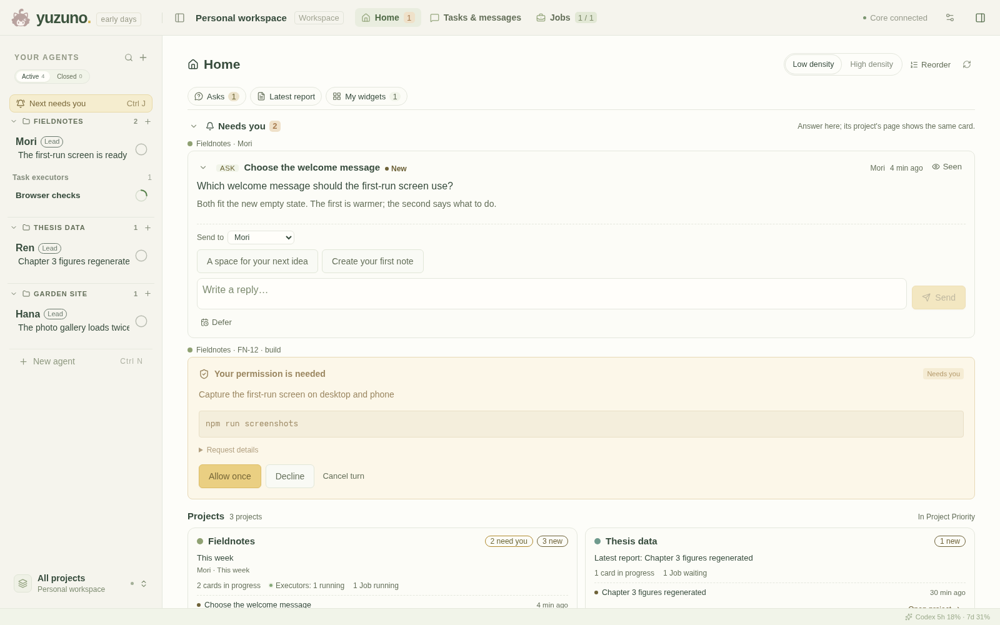
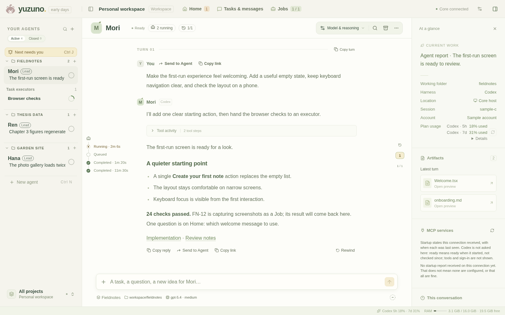
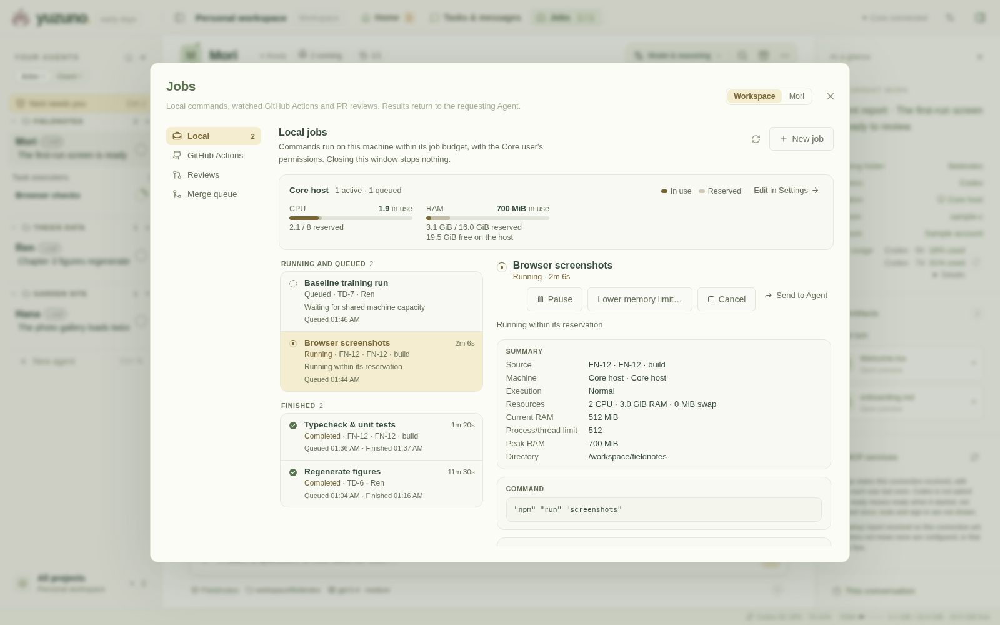

<p align="center">
  
</p>

<h1 align="center">Yuzuno</h1>

<p align="center"><strong>A home for your coding agents.</strong><br />
Claude Code, Codex and OpenCode, your projects, and the work that carries on between conversations.</p>

<p align="center">
  <a href="https://github.com/YuzukiS/Yuzuno/actions/workflows/ci.yml"></a>
  <a href="#status-and-limits"></a>
  <a href="LICENSE"></a>
  <a href="docs/independent-core.md#supported-platforms"></a>
</p>

<p align="center">
  <a href="#get-started"><strong>Get started</strong></a> ·
  <a href="#what-it-does">Features</a> ·
  <a href="#how-it-works">How it works</a> ·
  <a href="#status-and-limits">Status</a> ·
  <a href="CONTRIBUTING.md">Contribute</a> ·
  <a href="README.zh-CN.md">简体中文</a>
</p>

Yuzuno is a personal workspace for work that spans many agents and many turns. One **Core** keeps your Agents, Projects, tasks, background Jobs and reviews, and the decisions waiting for you. Open it in a browser, the desktop app or on your phone; close the window and the work goes on. The Claude Code, Codex and OpenCode you already use keep doing the model work, with their own sign-ins.



<p align="center"><em>Screenshots on this page show fictional sample data.</em></p>

## What it does

| | |
| --- | --- |
| **Your agents, side by side** | Conversations with Claude Code, Codex and OpenCode (experimental): tool calls, approvals, follow-ups, images and native sub-agents. Run an Agent on the Core's computer, or on a Linux or macOS machine over SSH. |
| **A Home that says what needs you** | Questions waiting for your answer, a page per Project whose cards its Agents keep current (reports, statuses, tables, metrics), and the load on each machine. Tell a Project what you need; its lead turns it into cards and hands each one to an Agent. |
| **Tasks that outlive a turn** | Projects have leads. A task gets an executor Agent of its own, started from a template you keep, with fixed working materials. Agents write to each other through a durable mailbox, and results go back to whoever dispatched the work. Routing picks the harness, model and account or API key for each executor. |
| **Background work with a budget** | Builds, tests and research commands queue within a CPU and memory budget, with logs and checked output files. Chain stages, declare NVIDIA GPU needs, and pause local work when you need the machine. Jobs run on the Core's computer, on SSH machines, or on Windows beside a WSL Core. |
| **Delivery you can check** | Pull requests linked to tasks, GitHub CI watches, independent review rounds on a fixed revision, and a merge queue that lands a reviewed pull request only once CI has tested exactly what lands. Completion, acceptance and merge stay separate facts. |
| **Previews of what you build** | Register a Project's web service, such as a Vite dev server, Jupyter or TensorBoard, and open it from the Projects dialog. A Job can serve it, and the dialog shows whether it answers. |
| **Signed updates** | A managed installation updates from signed releases when its Agents are idle and checks its health afterwards, with or without a GitHub sign-in. Back up, verify and restore a Workspace with one command each. |
| **Wherever you are** | A browser; the Windows and Mac desktop apps, whose taskbar or dock icon counts what needs you; and your phone, through a private Tailscale address, with push notifications from the Home Screen. |

### Follow the work, then get back to yours

See what an Agent is doing, inspect a tool call, answer an approval or send a follow-up without opening another terminal. Native sub-agents stay attached to their parent conversation, and account usage shows when the runtime reports it. A Codex or OpenCode conversation can be [rewound](docs/rewind.md) to before a turn.



### Give long-running work its own place

Jobs keep commands, resource requests, status, logs and outputs together. Dependent stages start after their prerequisites succeed, and CPU work can proceed while a GPU stage waits for a device. A finished Job sends its result back to the Agent that started it.



On a Linux Core, local CPU and memory limits are enforced through cgroups. GPU admission reserves declared capacity; it does **not** cap GPU memory. [Research pipelines and GPU Jobs](docs/research-jobs-gpu.md) and [Jobs on remote machines](docs/research-jobs-remote.md) describe what each kind of machine enforces.

## Get started

Choose where Core runs: a Linux x86_64 computer or WSL2 on Windows. Install and sign in to Claude Code, Codex or both there first; Yuzuno uses those sign-ins and never copies them.

### Linux: install a signed release

Signed Core releases for Linux x86_64 are on the [Releases page](https://github.com/YuzukiS/Yuzuno/releases). The [install guide](docs/independent-core.md) downloads one, verifies it with `minisign`, installs it as a managed installation and starts it, without a source checkout. Then open **http://127.0.0.1:4317** in a browser. The same guide connects a browser or the desktop app on another computer.

### Desktop apps

The Windows desktop app is on the Releases page (`desktop-…`). It connects to a Core in WSL and can start one it has connected to before; the [desktop guide](desktop/README.md) covers it. A Mac connects through an SSH tunnel to a Core on Linux; [macOS Core](docs/macos-core.md) is being built.

### Run from source

On Linux or WSL, install Git, Rust, a C compiler and linker, Node.js and npm, Python 3, and the agent CLI you want to use. CI uses Rust **1.97.1** and Node **22.23.2**; Core also needs Node at runtime for result validation and Claude Agents.

```sh
git clone https://github.com/YuzukiS/Yuzuno.git
cd Yuzuno
npm --prefix web ci
npm --prefix web run build
cargo build --locked

# Optional: enable Claude Agents. This installs the Claude Agent SDK from npm.
npm --prefix runtimes/claude ci --ignore-scripts --omit=optional

python3 scripts/launch.py core
```

Open **http://127.0.0.1:4317**, create an Agent, choose its runtime and project folder, and send a request. `--cwd`, `--port` and `--data-dir` choose the default project folder, the port and a separate Workspace; `python3 scripts/launch.py core --help` lists the rest.

### What you need

| Part | Supported |
| --- | --- |
| **Core** | Linux x86_64 with glibc 2.35 or newer, including WSL2 on Windows. |
| **Clients** | Chromium-based browsers; the Windows desktop app; the Mac app, built from source; a phone's browser through the [phone entry](docs/independent-core.md#connect-from-a-phone-tailscale-serve). An iPhone app builds from source; there is no Linux desktop app. |
| **Agent runtimes** | Claude Code (with Node.js 20 or newer), Codex, or [OpenCode](docs/opencode.md) (experimental), installed and signed in where the Agent runs. |
| **Agent machines** | The Core's computer, or Linux and macOS machines reached over SSH with Python 3. |
| **Jobs** | Linux: a systemd user manager with cgroup v2 `cpu`, `memory` and `pids`, which enforce each Job's limits. Macs over SSH run Jobs in limited mode, where limits are recorded, not enforced. |

The [support matrix](docs/independent-core.md#supported-platforms) separates what was tested from what is planned.

## How it works

**Core owns the Workspace; a client is a window into it.** Core keeps Projects, tasks, conversations and Jobs in SQLite, serves the UI, and talks to the native runtimes. Closing a browser or desktop window leaves Core and its Agents running.

- **Local Agents** use the Core computer's files and CLI sign-ins. **SSH Agents** use the remote machine's; add and check machines in Settings.
- **Core listens on loopback only and has no user accounts.** Another computer reaches it through an [SSH tunnel](docs/independent-core.md#connect-from-another-computer); a phone through [Tailscale Serve](docs/independent-core.md#connect-from-a-phone-tailscale-serve), which admits one Tailscale login. Never expose Core's port to a network.
- **GitHub** pull requests, CI watches and the merge queue use a signed-in `gh` on the Core computer. CI watches observe workflows; they never start or cancel them. The merge queue writes to a repository only after you turn it on for that repository.
- **Projects** group Agents and tasks without making them share a working tree. You choose each Project's leads; see [Agent kinds, Project leads and executor templates](docs/executor-model.md).

### Data and updates

A Workspace is one folder: the one Core starts with (`--data-dir`), or else `yuzuno/workspace` in the system's data folder (`~/.local/share` on Linux, `~/Library/Application Support` on macOS). Back it up with `yuzuno-workspace --backup-to <folder>`, check a backup with `--verify-backup` and restore it into a new folder with `--restore-backup`. A backup leaves out the native CLIs' sign-ins and session histories, and your project folders. [Workspace data](docs/workspace-data.md) covers backups, moving an older Workspace and opening it with older Cores.

A managed installation updates itself from signed releases in **Settings → Updates**, waiting until Agents are idle and checking Core's health after the switch ([Workspace updates](docs/workspace-updates.md)). Core releases carry Core, the web UI and the Claude bridge; the desktop app updates separately, and the native CLIs update on their own ([Updates and platform support](docs/updates-and-platforms.md)).

## Status and limits

Yuzuno is an early alpha in active development, published as source and as signed Core releases. This README describes the current source, which can be ahead of the latest release.

- **No user accounts.** Anyone who can reach Core's port can use the Workspace; keep it on loopback.
- **Jobs are resource control, not a sandbox.** They run as the Core's user, outside the Agents' sandboxes.
- **Windows runs Core only in WSL2.** **macOS Core is [being built](docs/macos-core.md)**; a Mac connects to a Core on Linux for now. There is no Linux aarch64 package yet.
- **The apps are not signed by a recognised publisher.** Windows may warn about the installer; the Mac app is signed ad hoc and not notarized; the iPhone app is built from source and lapses after about a week.
- **OpenCode Agents are experimental**, and some features differ by runtime (for example [rewind](docs/rewind.md)).

The [install guide](docs/independent-core.md#what-was-tested) records what was tested and what remains. Commits, pull requests and releases cited in older docs (for example `f5626f7`, `#164` or core.12) come from the former private repository `YuzukiS/Yuzuno-dev` and are not in this repository's history.

Bug reports and focused contributions are welcome; start with [Contributing](CONTRIBUTING.md). Report a security problem privately through [GitHub's private vulnerability reporting](https://github.com/YuzukiS/Yuzuno/security/advisories/new), as [Security](docs/SECURITY.md) describes.

## Development

| Path | Responsibility |
| --- | --- |
| `core/` | Rust, SQLite, native runtimes, tasks, Jobs, reviews and CI |
| `web/` | React UI and Vite build |
| `runtimes/claude/` | Bridge to the official Claude Agent SDK |
| `desktop/` | Tauri v2 client window for Windows and macOS |
| `ios/` | iPhone client window |
| `scripts/` | Launch, isolation and build helpers |
| `.agents/skills/yuzuno/` | Workspace tool guide for Agents |

For frontend work, keep Core running and use `npm --prefix web run dev`. For Core changes, use a separate port and data folder to protect your everyday Workspace. [Contributing](CONTRIBUTING.md) lists focused checks and the full suite. Agents developing inside Yuzuno follow the [Workspace skill](.agents/skills/yuzuno/SKILL.md) and put resource-heavy checks in managed Jobs.

More: [Claude bridge](runtimes/claude/README.md) · [Release workflow](docs/core-release.md) · [When the window can't show the app](docs/diagnostics.md) · [Screenshot sources](docs/images/README.md)

## License

Yuzuno is licensed under the **[Apache License 2.0](LICENSE)**, including the character images in `web/src/assets/` ([asset notes](web/src/assets/README.md)). The following keep their own terms:

- The bundled Noto Sans SC subset, under the [SIL Open Font License 1.1](web/src/assets/fonts/LICENSE-NotoSansSC.txt).
- Third-party dependencies, which the build installs from their registries. Among them is the Claude Agent SDK, which the optional Claude bridge installs from npm under Anthropic's terms. See [Claude reuse](docs/claude-reuse.md) and [the SDK notes](docs/public-readiness.md#the-claude-agent-sdk).

Release bundles include notices alongside Core and the Claude runtime (`licenses/`), the built UI (`web/licenses/`), and the result validator (`runtimes/result-validator/THIRD_PARTY_NOTICES.txt`). They are generated from the build inputs; see [license packaging](docs/core-release.md#ci-artifact-and-compatibility).
