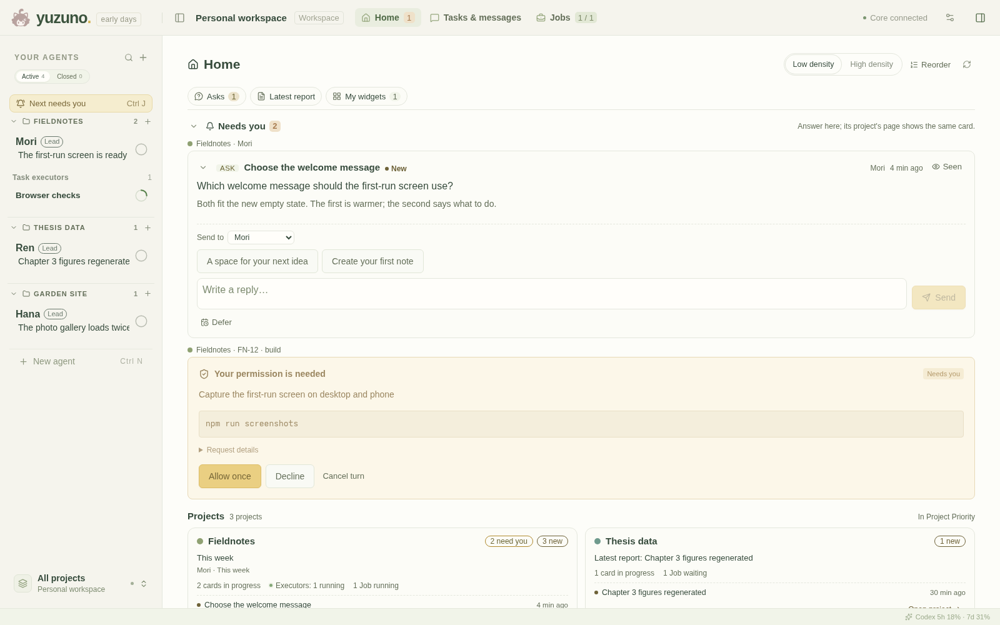
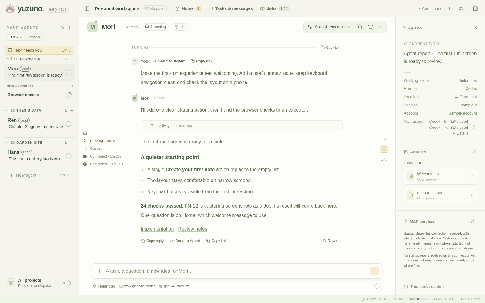
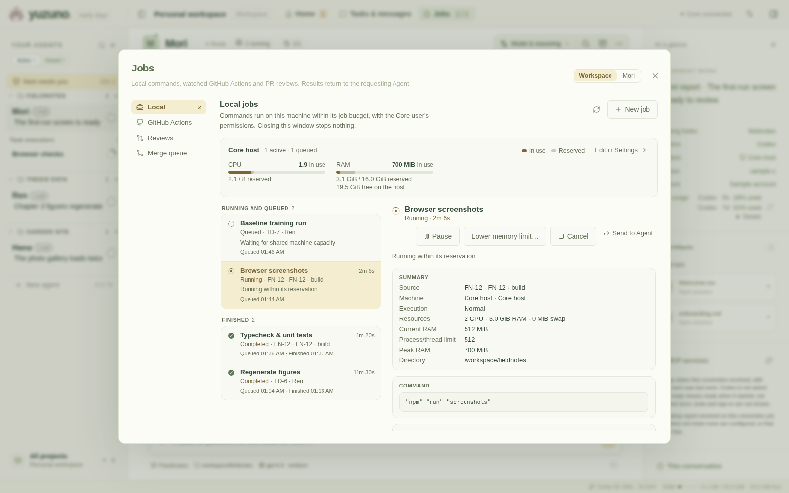

<p align="center">
  
</p>

<h1 align="center">Yuzuno</h1>

<p align="center"><strong>给你的 coding agent 一个家。</strong><br />
Claude Code、Codex 和 OpenCode，你的项目，以及在对话之间继续进行的工作。</p>

<p align="center">
  <a href="https://github.com/YuzukiS/Yuzuno/actions/workflows/ci.yml"></a>
  <a href="#现状与限制"></a>
  <a href="LICENSE"></a>
  <a href="docs/independent-core.md#supported-platforms"></a>
</p>

<p align="center">
  <a href="#开始使用"><strong>开始使用</strong></a> ·
  <a href="#它能做什么">功能</a> ·
  <a href="#它怎么工作">工作方式</a> ·
  <a href="#现状与限制">现状</a> ·
  <a href="CONTRIBUTING.md">参与贡献</a> ·
  <a href="README.md">English</a>
</p>

Yuzuno 是一个个人工作空间，给那些要跨多个 Agent、跨很多轮对话才能做完的工作用。一个 **Core** 保管你的 Agent、项目、任务、后台 Job 和审查，以及等你拿主意的事。你可以在浏览器、桌面应用或手机上打开它；关掉窗口，工作照常继续。模型的活仍由你已经在用的 Claude Code、Codex 和 OpenCode 来做，用它们各自的登录。

> 本文是 [README.md](README.md) 的中文版。两者不一致时，以英文版为准。



<p align="center"><em>本页截图里都是虚构的示例数据。</em></p>

## 它能做什么

| | |
| --- | --- |
| **Agent 并排在一处** | 和 Claude Code、Codex、OpenCode（实验性）的对话：工具调用、审批、追问、图片和原生子 Agent。Agent 可以跑在 Core 所在的电脑上，也可以经 SSH 跑在 Linux 或 macOS 机器上。 |
| **Home 告诉你什么事需要你** | 等你回答的提问；每个项目一页，上面的卡片由它的 Agent 持续更新（报告、状态、表格、指标）；还有每台机器的负载。对项目说你要什么，它的负责人会把它拆成卡片，交给合适的 Agent。 |
| **任务比一轮对话活得长** | 项目有负责人（lead）。每个任务有自己的执行者 Agent，按你保存的模板创建，带着固定的工作材料。Agent 之间通过持久的邮箱通信，结果回到派发它的人手里。路由为每个执行者选好工具、模型和账号或 API key。 |
| **有预算的后台工作** | 构建、测试和研究命令在 CPU 和内存预算内排队，带日志和经过核对的输出文件。可以把几个阶段串起来、声明需要的 NVIDIA GPU，也可以在你要用电脑时暂停本机的工作。Job 可以跑在 Core 所在的电脑上、SSH 机器上，或者 WSL Core 旁边的 Windows 上。 |
| **交付可以核对** | 关联到任务的 pull request、GitHub CI 监视、针对固定版本的独立审查轮次，以及一个合并队列：只有 CI 测过的正好是要合入的内容时，才合入审查过的 pull request。完成、验收和合入是三件分开记录的事。 |
| **预览你做的东西** | 登记项目的网页服务，例如 Vite 开发服务器、Jupyter 或 TensorBoard，从项目对话框里打开。服务可以由 Job 来跑，对话框会显示它有没有应答。 |
| **签名的更新** | 托管安装从签过名的发布更新，等 Agent 都空闲了才切换，切换后检查 Core 的健康；有没有 GitHub 登录都行。备份、核对和恢复一个 Workspace 各只要一条命令。 |
| **你在哪都能用** | 浏览器；Windows 和 Mac 桌面应用，任务栏或 Dock 图标上会显示需要你处理的数量；手机则通过私有的 Tailscale 地址访问，加到主屏幕后能收推送通知。 |

### 跟上进度，然后回去做你自己的事

不用另开终端，就能看 Agent 在做什么、查看一次工具调用、回答审批或者追加一句。原生子 Agent 挂在它的父对话下面；运行时报告账号用量时，这里也会显示。Codex 或 OpenCode 的对话可以[回退](docs/rewind.md)到某一轮之前。



### 给长时间的工作一个自己的地方

Job 把命令、资源申请、状态、日志和输出放在一起。后面的阶段等前面的成功了才开始；某个 GPU 阶段在等显卡时，CPU 的工作照样往前走。Job 结束后，结果会回到启动它的 Agent。



在 Linux Core 上，本机 Job 的 CPU 和内存上限由 cgroup 强制执行。GPU 准入只预留声明的容量，**不**限制显存。各类机器各强制执行什么，见[研究流水线与 GPU Job](docs/research-jobs-gpu.md) 和[远程机器上的 Job](docs/research-jobs-remote.md)。

## 开始使用

先选 Core 跑在哪里：一台 Linux x86_64 电脑，或者 Windows 上的 WSL2。先在那里装好并登录 Claude Code、Codex 或两者；Yuzuno 用这些登录，从不复制它们。

### Linux：安装签名的发布

Linux x86_64 的签名 Core 发布在 [Releases 页](https://github.com/YuzukiS/Yuzuno/releases)上。[安装指南](docs/independent-core.md)带你下载一个发布、用 `minisign` 验证、作为托管安装装好并启动，不需要源码。然后在浏览器里打开 **http://127.0.0.1:4317**。同一份指南也讲了怎么从另一台电脑上的浏览器或桌面应用连过来。

### 桌面应用

Windows 桌面应用在 Releases 页上（`desktop-…`）。它连接 WSL 里的 Core，也能启动一个它连接过的 Core；见[桌面应用说明](desktop/README.md)。Mac 目前通过 SSH 隧道连接 Linux 上的 Core；[macOS 上的 Core](docs/macos-core.md) 正在做。

### 从源码运行

在 Linux 或 WSL 上装好 Git、Rust、C 编译器和链接器、Node.js 和 npm、Python 3，以及你要用的 Agent CLI。CI 用的是 Rust **1.97.1** 和 Node **22.23.2**；Core 运行时也需要 Node，用于核对结果和运行 Claude Agent。

```sh
git clone https://github.com/YuzukiS/Yuzuno.git
cd Yuzuno
npm --prefix web ci
npm --prefix web run build
cargo build --locked

# 可选：启用 Claude Agent。这会从 npm 安装 Claude Agent SDK。
npm --prefix runtimes/claude ci --ignore-scripts --omit=optional

python3 scripts/launch.py core
```

打开 **http://127.0.0.1:4317**，新建一个 Agent，选好运行时和项目文件夹，发一条请求。`--cwd`、`--port` 和 `--data-dir` 分别设定默认的项目文件夹、端口和一个独立的 Workspace；其余选项见 `python3 scripts/launch.py core --help`。

### 需要什么

| 部分 | 支持 |
| --- | --- |
| **Core** | Linux x86_64，glibc 2.35 或更新，包括 Windows 上的 WSL2。 |
| **客户端** | Chromium 系浏览器；Windows 桌面应用；Mac 应用（从源码构建）；通过[手机入口](docs/independent-core.md#connect-from-a-phone-tailscale-serve)用手机浏览器。iPhone 应用可以从源码构建；没有 Linux 桌面应用。 |
| **Agent 运行时** | Claude Code（需要 Node.js 20 或更新）、Codex 或 [OpenCode](docs/opencode.md)（实验性），装在 Agent 运行的机器上并已登录。 |
| **Agent 所在机器** | Core 所在的电脑，或经 SSH 访问、装有 Python 3 的 Linux 和 macOS 机器。 |
| **Job** | Linux：systemd 用户管理器，cgroup v2 带 `cpu`、`memory` 和 `pids`，由它们强制执行每个 Job 的上限。经 SSH 的 Mac按 limited 模式运行 Job：上限只记录，不强制。 |

[支持矩阵](docs/independent-core.md#supported-platforms)分开写了哪些测过、哪些还是计划。

## 它怎么工作

**Core 拥有 Workspace，客户端只是看它的窗口。** Core 把项目、任务、对话和 Job 存在 SQLite 里，提供界面，并和原生运行时打交道。关掉浏览器或桌面窗口，Core 和它的 Agent 照常运行。

- **本机 Agent** 用 Core 所在电脑的文件和 CLI 登录；**SSH Agent** 用远程机器的。在设置里添加和检查机器。
- **Core 只监听本机回环地址，也没有用户账号。** 另一台电脑通过 [SSH 隧道](docs/independent-core.md#connect-from-another-computer)连过来；手机通过 [Tailscale Serve](docs/independent-core.md#connect-from-a-phone-tailscale-serve)，它只放行一个 Tailscale 登录。不要把 Core 的端口暴露到网络上。
- **GitHub** 的 pull request、CI 监视和合并队列用 Core 所在电脑上已登录的 `gh`。CI 监视只观察 workflow，从不启动或取消它们。合并队列只有在你为某个仓库打开开关后才会往那个仓库写。
- **项目**把 Agent 和任务归在一起，但不要求它们共用一个工作目录。每个项目的负责人由你来选；见 [Agent 种类、项目负责人和执行者模板](docs/executor-model.md)。

### 数据与更新

一个 Workspace 就是一个文件夹：Core 启动时指定的那个（`--data-dir`），否则是系统数据目录下的 `yuzuno/workspace`（Linux 上是 `~/.local/share`，macOS 上是 `~/Library/Application Support`）。用 `yuzuno-workspace --backup-to <文件夹>` 备份，`--verify-backup` 核对备份，`--restore-backup` 恢复到一个新文件夹。备份不包括原生 CLI 的登录和会话记录，也不包括你的项目文件夹。备份、迁移旧的 Workspace、用旧版 Core 打开它，见 [Workspace 数据](docs/workspace-data.md)。

托管安装在 **设置 → 更新** 里从签名的发布自我更新：等 Agent 都空闲了才切换，切换后检查 Core 的健康（[Workspace 更新](docs/workspace-updates.md)）。Core 的发布包含 Core、网页界面和 Claude 桥接；桌面应用单独更新，原生 CLI 各自更新（[更新与平台支持](docs/updates-and-platforms.md)）。

## 现状与限制

Yuzuno 是一个仍在积极开发的早期 alpha，以源码和签名的 Core 发布两种形式公开。本 README 描述的是当前源码，可能比最新的发布要新。

- **没有用户账号。** 能访问 Core 端口的人都能使用这个 Workspace，所以只让它留在本机回环地址上。
- **Job 是资源控制，不是沙箱。** 它们以 Core 的用户身份运行，在 Agent 的沙箱之外。
- **Windows 上 Core 只能跑在 WSL2 里。** **[macOS 上的 Core](docs/macos-core.md) 正在做**；目前 Mac 连接 Linux 上的 Core。 还没有 Linux aarch64 的包。
- **应用都没有公认发布者的签名。** Windows 可能会对安装程序发出警告；Mac 应用是 ad hoc 签名、没有公证；iPhone 应用要从源码构建，大约一周后失效。
- **OpenCode Agent 还是实验性的**，有些功能因运行时而异（例如[回退](docs/rewind.md)）。

[安装指南](docs/independent-core.md#what-was-tested)记录了测过什么、还差什么。较早的文档里引用的提交、pull request 和发布（例如 `f5626f7`、`#164` 或 core.12）来自以前的私有仓库 `YuzukiS/Yuzuno-dev`，不在本仓库的历史里。

欢迎报告问题和聚焦的贡献，从[参与贡献](CONTRIBUTING.md)开始。安全问题请按 [Security](docs/SECURITY.md) 的说明，通过 [GitHub 的私密漏洞报告](https://github.com/YuzukiS/Yuzuno/security/advisories/new)提交。

## 开发

| 路径 | 负责 |
| --- | --- |
| `core/` | Rust、SQLite、原生运行时、任务、Job、审查和 CI |
| `web/` | React 界面和 Vite 构建 |
| `runtimes/claude/` | 连接官方 Claude Agent SDK 的桥接 |
| `desktop/` | Windows 和 macOS 的 Tauri v2 客户端窗口 |
| `ios/` | iPhone 客户端窗口 |
| `scripts/` | 启动、隔离和构建脚本 |
| `.agents/skills/yuzuno/` | 给 Agent 的 Workspace 工具指南 |

改前端时，让 Core 跑着，用 `npm --prefix web run dev`。改 Core 时，用另一个端口和数据文件夹，保护你日常用的 Workspace。[参与贡献](CONTRIBUTING.md)列出了聚焦的检查和完整的测试集。在 Yuzuno 里开发的 Agent 按 [Workspace skill](.agents/skills/yuzuno/SKILL.md) 做事，把耗资源的检查放进托管 Job。

更多：[Claude 桥接](runtimes/claude/README.md) · [发布流程](docs/core-release.md) · [窗口显示不出应用时](docs/diagnostics.md) · [截图来源](docs/images/README.md)

## 许可证

Yuzuno 以 **[Apache License 2.0](LICENSE)** 授权，包括 `web/src/assets/` 里的角色图片（[素材说明](web/src/assets/README.md)）。以下各有自己的条款：

- 随附的 Noto Sans SC 子集，采用 [SIL Open Font License 1.1](web/src/assets/fonts/LICENSE-NotoSansSC.txt)。
- 构建时从各自仓库安装的第三方依赖。其中包括 Claude Agent SDK，由可选的 Claude 桥接按 Anthropic 的条款从 npm 安装。见 [Claude reuse](docs/claude-reuse.md) 和 [SDK 说明](docs/public-readiness.md#the-claude-agent-sdk)。

发布包里，Core 和 Claude 运行时旁边（`licenses/`）、构建好的界面（`web/licenses/`）和结果核对器（`runtimes/result-validator/THIRD_PARTY_NOTICES.txt`）都附有声明。它们从构建输入生成；见 [license packaging](docs/core-release.md#ci-artifact-and-compatibility)。
